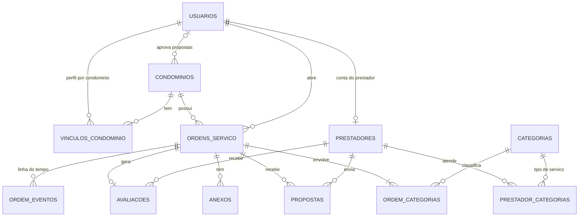

# CLAUDE.md — Backend (API do CondoCheck)

Este repositório é a **API**. O frontend (Next.js) vive em outro repositório (`front`) e consome esta API.
Este arquivo é a fonte de verdade de regras de negócio e decisões técnicas do backend. Se algo aqui mudar, atualize aqui.
Plano de execução em etapas: **[TASKS.md](TASKS.md)** (marque os itens conforme concluir).

## 1. O que é o projeto

**CondoCheck** — plataforma para uma **administradora de condomínios** unir dois modelos: ordens de serviço de manutenção e marketplace de prestadores.
Ciclo: **ordem de serviço → propostas → comparação → transferência (administradora) → aprovação ou reprovação (aprovador do condomínio) → WhatsApp → nota fiscal (se exigida) → conclusão com comprovante de pagamento → avaliação**.
Hoje o processo é manual e lento (app "Alvo" + cotação por fora). Origem dos requisitos: entrevista com a PO Yasmin (18/09/2026), feedback do professor orientador (01/10/2026) e reunião com o professor (04/10/2026).

**Vocabulário:**
- **Ordem de serviço** por extenso nas mensagens (nunca a sigla "OS", nunca "chamado"). Código: `Ordem`, `StatusOrdem`, tabela `ordens_servico`, rotas `/api/ordens`.
- Quem atende é **prestador de serviço** (`Prestador`/`PRESTADOR`), nunca "fornecedor".
- A administradora **transfere para aprovação** (`TRANSFERIDA`), não "indica".
- **Tipo de serviço** (Elétrica, Piscina…) na tela; no código continua `Categoria`.

O front já tem o fluxo completo em modo mock. **O contrato da API é [front/lib/services.ts](../front/lib/services.ts) + [front/types/index.ts](../front/types/index.ts)**; o fluxo por perfil está em [front/docs/fluxo.md](../front/docs/fluxo.md).

## 2. Stack e decisões

| Camada | Escolha | Observação |
|---|---|---|
| Runtime / framework | Node.js 22 + **Express 5** + TypeScript (ESM, `module: NodeNext` → imports relativos com `.js`) | Sem NestJS, de propósito: curva de aprendizado menor |
| Validação | **Zod** | Um schema por rota (body/query/params) |
| ORM / migrations | **Prisma 6** | Schema em [prisma/schema.prisma](prisma/schema.prisma). Fixar `prisma@6` (a v7 mudou a config de datasource) |
| Banco | PostgreSQL — **Supabase** (prod), Docker (local) | Free: 500 MB, pausa após 7 dias sem uso |
| Autenticação | **Clerk** (`@clerk/express`) — e-mail+senha **e Google** | O front usa telas próprias (não o componente pronto do Clerk). Ver seção 6 e [docs/clerk-setup.md](docs/clerk-setup.md). **Não** usar JWT/bcrypt próprios (cards antigos do Trello estão desatualizados) |
| Upload de arquivos | **Supabase Storage** (bucket privado `anexos`; pastas `ordens/{id}/abertura/`, `formulario/`, `proposta/{propostaId}/`, `comprovacao/`, `nota-fiscal/`, `pagamento/`) atrás da interface `Storage` (`src/lib/storage`) | Free: 1 GB. Driver `s3` pronto para migrar a S3/**Cloudflare R2** trocando só variáveis (`STORAGE_DRIVER`). Sem emulador local: dev usa um projeto Supabase de dev. Ver [docs/storage.md](docs/storage.md) |
| Upload no servidor | `multer` (memória) | Máx. 5 MB; tipos aceitos por tipo de anexo (fotos JPG/PNG; formulário PDF/DOCX/XLSX; arquivos da proposta: todos esses; comprovação, nota fiscal e pagamento: JPG/PNG/PDF). Validar o tipo pelo conteúdo (magic bytes, `file-type`), não só pela extensão |
| WhatsApp | link `https://wa.me/<numero>?text=<msg>` | Sem API oficial, sem custo |
| Mapa | Embed do **OpenStreetMap** no front; coordenadas em `condominios.latitude/longitude` | Sem chave de API e sem custo. Geocodificar o endereço no cadastro do condomínio (ex.: Nominatim, respeitando a política de uso) ou preencher manualmente |
| Deploy da API | **Render** (Web Service Docker, plano free, [render.yaml](render.yaml)) | Railway descartado (sem plano gratuito utilizável). Render free dorme após 15 min sem tráfego (cold start ~1 min). Imagem Docker = portável para Koyeb/Northflank/Cloud Run. Alternativas na seção 12 |
| CI/CD | **GitHub Actions** | Lint + typecheck + testes + build em PR; deploy na `main` via *Deploy Hook* do Render |
| Testes | Vitest + Supertest | Clerk substituído por um dublê (`tests/setup.ts`); rotas testadas contra um **Postgres de verdade** (banco `chamados_test`, criado e migrado pelo `tests/global-setup.ts`; no CI, serviço `postgres`) |

## 3. Perfis e permissões

Uma **conta por pessoa** (`usuarios`), com perfil **por condomínio**:
- `ADMIN` = `usuarios.administradora = true` (equipe da administradora; vê todos os condomínios).
- `SINDICO`, `FISCAL`, `ZELADOR` = `vinculos_condominio.perfil` (um por condomínio; a mesma pessoa pode ser fiscal num e síndica noutro).
- `PRESTADOR` = tem linha em `prestadores`.
- **Morador não tem acesso.**

**Perfil ativo:** o front escolhe e manda no cabeçalho `X-Perfil`. A API confere que a pessoa tem esse perfil e usa-o para o **escopo das listagens** (condomínios onde atua com aquele perfil). A **autorização de cada ação** usa o vínculo da pessoa **no condomínio da ordem** e se ela é o aprovador dali.

**Aprovador:** `condominios.aprovador_id` = pessoa ativa vinculada ao condomínio (qualquer perfil), ou `null` = a própria administradora aprova. "Gestor" de uma ordem = ADMIN, SINDICO daquele condomínio ou o aprovador.

| Ação | ADMIN | SINDICO | FISCAL | ZELADOR | Aprovador | PRESTADOR |
|---|:-:|:-:|:-:|:-:|:-:|:-:|
| Cadastros (condomínios, pessoas, tipos de serviço, prestadores) | ✔ | | | | | |
| Aprovar autocadastro / desativar / reativar prestador | ✔ | | | | | |
| Consultar prestadores | ✔ | ✔ | | | | |
| Abrir ordem de serviço | ✔ | ✔ | ✔ | só tipos com `zelador_pode_abrir` | | |
| Tipo de serviço `interna` (ex.: TI) | ✔ | | | | | |
| Exigir nota fiscal / anexar formulário na abertura | ✔ | ✔ | ✔ | | | |
| Ver ordens | todas | do condomínio | do condomínio | só as que abriu | | mural + as próprias propostas |
| Ver/comparar propostas | ✔ | ✔ | | | ✔ | só a própria |
| Transferir para aprovação | ✔ | | | | | |
| Aprovar / reprovar a proposta transferida | quando o condomínio não tem aprovador (aprova direto de `ABERTO`) | | | | ✔ | |
| WhatsApp, concluir (com comprovante de pagamento), cancelar, avaliar | ✔ | ✔ | | | ✔ | |
| Enviar/editar/cancelar proposta (com o formulário devolvido) | | | | | | ✔ (APROVADO e ativo) |
| Anexar nota fiscal e comprovação | | | | | | ✔ (só o da proposta `ACEITA`) |

- **Mural do prestador:** ordens `ABERTO`, dentro do prazo, com **qualquer** tipo de serviço que ele atende; só prestador `APROVADO` e `ativo`. Expõe título, tipos, descrição, urgência, fotos, formulário, selo "Exige nota fiscal", bairro/cidade. **Nunca** endereço completo nem nome do condomínio (LGPD).
- Avaliações mostram nota e comentário, **sem** identificar o condomínio avaliador.
- **Mapa / localização:** quem é do condomínio recebe coordenadas exatas e endereço. O **prestador só recebe coordenadas arredondadas a 2 casas (~1 km) e sem endereço** enquanto não for o aprovado (`proposta.status = ACEITA`). O arredondamento é feito **na API**.
- **Desativado** (pessoa ou prestador com `ativo = false`): `GET /me` responde **403** (o front mostra "acesso desativado").

## 4. Fluxo da ordem de serviço

```
ABERTO ──(administradora transfere)──▶ AGUARDANDO_APROVACAO ──(aprovador aprova)──▶ EM_EXECUCAO ──▶ CONCLUIDO ──▶ (avaliação)
  │  ▲                                     │                                           │ NF (se exigida)
  │  └──────────(aprovador reprova)────────┘                                           └ conclusão exige comprovante de pagamento
  └──(administradora aprova direto, quando o condomínio não tem aprovador)──▶ EM_EXECUCAO
  cancelar (gestores, em qualquer estado antes de CONCLUIDO) ──▶ CANCELADO
```

- **Prazo de propostas** (`prazoPropostasAte`): NORMAL = criação + 48 h; URGENTE = `prazoUrgenteHoras` informado na abertura (a tela oferece 1/2/4/8 h, padrão 2 h). Depois do prazo, o servidor recusa propostas novas, mas a administradora ainda pode transferir uma existente.
- **Mínimo de 3 propostas:** o sistema *avisa*; não bloqueia.
- **Urgente** = imediato: destaque e ordenação no topo (sem push, ver seção 9).
- **Aprovar:** a proposta vira `ACEITA`, **todas as demais viram `RECUSADA` de uma vez**, ordem vai para `EM_EXECUCAO`. `GET /ordens/:id/whatsapp` devolve o link `wa.me` do prestador com mensagem pronta; quem envia é o condomínio/administradora.
- **Reprovar** (só a proposta `TRANSFERIDA`, motivo opcional em `propostas.motivo_recusa`): proposta `RECUSADA`, ordem volta para `ABERTO`, evento `REPROVADA` (marco). As demais continuam em disputa.
- Só existe **1 proposta TRANSFERIDA/ACEITA por ordem** (índice único parcial).
- **Formulário para o prestador:** quem abre pode anexar formulários (`FORMULARIO`: PDF/DOCX/XLSX). Se houver, **a proposta só é aceita com pelo menos um arquivo devolvido** (`PROPOSTA`, ligado a `proposta_id`); ao editar, os já enviados contam. Senão 409 `FORMULARIO_OBRIGATORIO`.
- **Nota fiscal:** `exige_nota_fiscal` é definido na abertura. O prestador da proposta `ACEITA` anexa (`NOTA_FISCAL`, evento `NOTA_FISCAL_ENVIADA`). Enquanto faltar, concluir responde 409 `NOTA_FISCAL_PENDENTE`.
- **Concluir** exige **comprovante de pagamento** (`PAGAMENTO`, multipart `comprovantes` em `PATCH /ordens/:id/concluir`), visível também ao prestador.
- **Comprovação do serviço** (opcional): só o prestador da proposta `ACEITA`, com a ordem em `EM_EXECUCAO` ou `CONCLUIDO`; evento `COMPROVACAO_ENVIADA`. Não bloqueia a conclusão.
- **Avaliação:** só ordem `CONCLUIDO`, 1 por ordem, nota 1–5 + comentário.
- Aprovar prestador exige `emiteNotaFiscal = true`.
- **Linha do tempo:** todo service que muda estado, transfere/aprova/reprova ou anexa NF/comprovação grava `ordem_eventos` **na mesma transação**. Marcos (`marco = true`): abertura, 3ª proposta, aprovação, reprovação, conclusão, cancelamento.

## 5. Requisitos

### Funcionais

| Cód. | Descrição |
|---|---|
| RF01 | Cadastrar/gerenciar pessoas (administradora, síndico, fiscal, zelador) com perfil por condomínio, condomínios (com aprovador) e tipos de serviço |
| RF02 | Abrir ordem de serviço: título, um ou mais tipos de serviço, local, urgência, descrição, exigir nota fiscal (sim/não) |
| RF02a | Foto opcional; front incentiva o envio (foto agiliza a manutenção) |
| RF03 | Comparar propostas lado a lado (valor, prazo de execução, disponibilidade, nota do prestador) |
| RF04 | Administradora transfere a proposta; o aprovador do condomínio aprova (aceite final, **independe do valor**). Sem aprovador definido, a administradora aprova direto |
| RF05 | Buscar/filtrar prestadores por categoria |
| RF06 | Avaliar prestador: **nota geral 1–5** + comentário, por um gestor (administradora, síndico ou aprovador) |
| RF06b | Avaliações visíveis a síndicos e admin, nunca a moradores |
| RF07 | Concluir (com comprovante de pagamento) ou cancelar ordem de serviço |
| RF08 | Histórico de ordens de serviço com situação |
| RF09 | Prestador entra por **autocadastro + aprovação** da administradora, ou cadastrado por ela (já aprovado); pode ser desativado/reativado |
| RF09a | Cadastro de prestador informa se emite nota fiscal (obrigatório); aprovação exige "sim" |
| RF10 | Prestador se cadastra por e-mail + senha ou Google (Clerk), depois informa telefone/WhatsApp, categorias, área de atuação e nota fiscal |
| RF12 | Prestador vê mural filtrado pelas suas categorias |
| RF13 | Proposta: valor, data/hora de disponibilidade, tempo de execução (todos obrigatórios) |
| RF14 | Editar/cancelar proposta antes do aceite |
| RF15 | Prestador acompanha aceite/recusa **no painel** (sem push, ver seção 9) |
| RF16 | Histórico de ordens de serviço atendidas pelo prestador |
| RF17 | Link `wa.me` com mensagem pré-pronta ao aprovar (é também o "aviso" ao prestador) |
| RF18 | Média de avaliação por prestador mantida automaticamente |
| RF20 | Controle de acesso por perfil (seção 3) |
| RF21 | Urgente tratado como imediato (destaque + prioridade) |
| RF22 | Prazo de propostas: normal até 48 h; urgente imediato |
| RF23 | Aviso quando houver menos de 3 propostas |
| RF24 | Tipo de serviço de "uso interno" (ex.: TI), só a administradora abre; tipos liberados para o zelador |
| RF25 | **Mapa do local** na ordem de serviço (OpenStreetMap, sem chave de API); prestador vê só a região aproximada até ser aprovado |
| RF26 | **Comprovação do serviço**: quem atendeu pode enviar fotos/PDF (opcional) |
| RF27 | **Histórico** (linha do tempo) da ordem de serviço, com marcos em destaque |
| RF28 | **Formulário** anexado na abertura (PDF/DOCX/XLSX); prestador devolve preenchido junto da proposta (obrigatório quando houver formulário) |
| RF29 | Aprovador **reprova** a proposta transferida (motivo opcional); a ordem volta para a administradora |
| RF30 | **Nota fiscal**: se a ordem exige, o prestador aprovado anexa e a conclusão fica travada até lá |
| RF31 | **Comprovante de pagamento** obrigatório na conclusão, visível ao prestador |
| RF32 | **Perfil por condomínio** e troca de perfil ativo ("Atuando como") |

Substituições em relação ao rascunho anterior: RF11 (login por celular+senha) virou e-mail+senha **ou Google** no Clerk; RF19 (notificar prestadores) virou o link do WhatsApp (RF17); RF06a (3 critérios) virou nota geral única.

### Não funcionais

| Cód. | Descrição |
|---|---|
| RNF01/11 | Responsivo; mesmo layout para todos os perfis (muda só permissão) — responsabilidade do front |
| RNF02 | Endpoints principais respondem em < 2 s |
| RNF03 | Senhas e sessões **delegadas ao Clerk** (a API nunca vê senha) |
| RNF04 | HTTPS em todo tráfego (Render e Vercel já fornecem) |
| RNF05 | Upload: até 5 MB por arquivo; tipos por uso (fotos JPG/PNG; formulário PDF/DOCX/XLSX; comprovação, NF e pagamento JPG/PNG/PDF) |
| RNF06 | Compatível com Chrome, Firefox, Edge e Safari |
| RNF07 | Suportar 50+ usuários simultâneos |
| RNF08 | Código versionado em Git |
| RNF10 | **LGPD**: dados isolados por `condominio_id`; toda query filtra pelo escopo do usuário |

## 6. Autenticação e usuários (Clerk)

- Clerk **free**: senha, e-mail e login social (Google); **login por SMS/celular é pago** e roles customizadas não existem no plano free. Por isso: login = e-mail + senha **ou Google**, e **o perfil vive no banco** (`usuarios.administradora`, `vinculos_condominio`, `prestadores`), não em claims do Clerk.
- **Login por celular (avaliado em set/2026):** o SMS do Clerk exige o plano Pro (US$ 25/mês) mais tarifa por mensagem; o Brasil não aparece na lista padrão de países. O celular fica só como dado de contato. Alternativa gratuita: **código de 6 dígitos por e-mail** (`signIn.emailCode`), ainda **não** implementado. Login por WhatsApp exigiria a API oficial — descartado.
- A tela de login/cadastro é **própria** (front, fluxos customizados do Clerk). Para a API é transparente: só valida o token da sessão.
- O front envia `Authorization: Bearer <token da sessão Clerk>` e `X-Perfil: <perfil ativo>`. Middlewares em [src/middlewares/auth.ts](src/middlewares/auth.ts):
  - `clerkSessao()` + `autenticar`: 401 sem sessão; carrega a conta em `req.conta` (`null` = sem cadastro). Todo acesso ao Clerk passa por [src/lib/clerk.ts](src/lib/clerk.ts).
  - `exigirConta`: 403 `SEM_CADASTRO` / `ACESSO_DESATIVADO` / `SEM_ACESSO`; resolve o perfil ativo (o do `X-Perfil` se a pessoa o tiver, senão o padrão, na mesma ordem do front) e monta `req.ctx = { usuario, perfil, perfis, condominioIds }` (`null` = todos, para ADMIN).
  - `exigirPerfil(...)`: 403 `PERFIL_SEM_PERMISSAO`.
  - Só `GET /me`, `POST /prestadores/cadastro` e `GET /categorias` dispensam `exigirConta`.
- **Vínculo por e-mail no 1º login:** pessoas e prestadores cadastrados pela administradora ficam com `clerk_user_id = null`. No 1º login, `autenticar` casa pelo **e-mail verificado** no Clerk (só confie em endereço verificado) e grava o `clerk_user_id`. `contaCriada` (front) = `clerk_user_id` preenchido.
- **Prestador por autocadastro:** conta Clerk sem linha em `usuarios` só pode chamar `POST /prestadores/cadastro`, que cria `usuarios` + `prestadores(PENDENTE, origem AUTOCADASTRO)`. Sem aprovação ele não vê o mural.
- **Prestador cadastrado pela administradora:** `POST /prestadores` cria `usuarios` (e-mail) + `prestadores(APROVADO, origem ADMINISTRADORA)`; a conta se liga pelo e-mail no 1º login.
- `GET /me`: **404** se não há linha em `usuarios` (front manda para o autocadastro); **403** se a pessoa ou o prestador está desativado.
- **Primeira pessoa da administradora:** `npm run seed` cria a partir de `SEED_ADMIN_EMAIL` (com os tipos de serviço iniciais).
- Autorização: middleware `exigirPerfil(...)` por rota (perfil ativo) + **regra e filtro de condomínio nos services** (nunca só no controller).

## 7. Modelo de dados

Schema completo em [prisma/schema.prisma](prisma/schema.prisma). Diagrama, dicionário de dados e regras: **[docs/modelagem-banco.md](docs/modelagem-banco.md)** (imagem: [docs/modelagem-banco.png](docs/modelagem-banco.png)).



Pontos de atenção:
- `mediaAvaliacao`/`totalAvaliacoes` em `prestadores` são desnormalizados: atualizar **na mesma transação** que grava a avaliação. `totalServicos` é derivado (ordens `CONCLUIDO` com a proposta dele `ACEITA`).
- Constraints em SQL (CHECKs, mime por tipo de anexo, índice único parcial, sequência do protocolo a partir de 101) ficam no fim da migration inicial; o topo do schema lista todas.
- O e-mail e o nome do contato do prestador ficam em `usuarios` (a conta); o serializer monta `Prestador.email`/`nomeContato`.
- Anexos: guardar só `storagePath` (`ordens/{id}/{pasta}/…`); a API gera **URL assinada** (curta duração) ao devolver a ordem.
- IDs são UUID; `ordens_servico.numero` é o protocolo legível (#101).
- **Seeds:** `npm run seed` (tipos de serviço + 1ª pessoa da administradora, idempotente) e `npm run seed:demo` (mesmos dados do mock do front; exige banco sem ordens — `npx prisma migrate reset` antes).

## 8. API

Prefixo `/api`. Toda rota exige sessão Clerk, exceto `GET /api/health` (consulta o banco; usado pelo health check do Render e pelo ping que mantém Render/Supabase acordados).
**Contrato: as funções de `front/lib/services.ts`** (rota, corpo e resposta tipados por `front/types/index.ts`). Serializer por módulo: `Decimal` → `number`, datas ISO, objetos aninhados prontos.

| Método e rota | Quem | Descrição |
|---|---|---|
| `GET /me` | qualquer conta | `MeApi`: `administradora`, `vinculos[{ condominio, perfil }]`, `condominiosAdministrados?`, `prestador?`. 404 sem cadastro; 403 desativado |
| `POST /prestadores/cadastro` | Clerk sem cadastro | Autocadastro → `PENDENTE` |
| `GET/PATCH /prestadores/me` | PRESTADOR | Meu cadastro (WhatsApp, tipos de serviço, área) |
| `GET /categorias` (`?todas=1`), `POST`, `PATCH /categorias/:id`, `GET /categorias/uso` | todos lêem; ADMIN grava | Tipos de serviço; `uso` = quantos prestadores atendem cada um |
| `GET/POST /condominios`, `GET/PATCH /condominios/:id` | ADMIN | Com `aprovadorId` (pessoa ativa vinculada ou `null`) |
| `GET/POST /pessoas`, `GET/PATCH /pessoas/:id` | ADMIN | E-mail único, `administradora`, `vinculos[]`, `ativo`; 409 `PESSOA_E_APROVADORA` ao desativar/desvincular o aprovador |
| `GET /prestadores` (`busca`, `categoriaId`, `situacao=PENDENTE\|ATIVO\|INATIVO`), `GET /prestadores/:id` | ADMIN, SINDICO | Lista (array, sem paginação, como o front espera: pendentes, ativos, inativos) e detalhe |
| `POST /prestadores`, `PATCH /prestadores/:id` | ADMIN | Cadastro pela administradora (já `APROVADO`) e edição |
| `PATCH /prestadores/:id/aprovar` · `/desativar` (`{ motivo? }`) · `/reativar` | ADMIN | Aprovar exige nota fiscal. Documento novo precisa ter dígitos verificadores válidos; o já gravado é mantido |
| `GET /prestadores/:id/historico` | ADMIN, SINDICO | `{ media, totalServicos, porCategoria[], prazoCumprido, ultimoServicoEm }`. Prazo cumprido = `concluido_em <= disponivel_em + tempo_execucao_horas` da proposta aceita |
| `POST /ordens` · `GET /ordens` · `GET /ordens/:id` | conforme seção 3 | Abrir (`categoriaIds[]`, `exigeNotaFiscal`, `prazoUrgenteHoras?`), listar com escopo do perfil ativo (urgentes primeiro; `totalPropostas`, `menorValor`, `valorContratado`), detalhar (`localizacao` filtrada, `eventos`, anexos com URL assinada, `minhaProposta` para prestador) |
| `POST /ordens/:id/anexos` · `/formularios` | quem abriu | Fotos (JPG/PNG, máx. 6) e formulário (PDF/DOCX/XLSX, enquanto `ABERTO` e sem propostas); 1 arquivo por requisição |
| `POST /ordens/:id/comprovacoes` · `/notas-fiscais` | prestador da proposta `ACEITA` | JPG/PNG/PDF |
| `POST /ordens/:id/transferir` | ADMIN | `{ propostaId }` → `AGUARDANDO_APROVACAO` |
| `POST /ordens/:id/aprovar` · `/reprovar` | aprovador (ou ADMIN se o condomínio não tem aprovador) | `{ propostaId }` / `{ propostaId, motivo? }` |
| `PATCH /ordens/:id/concluir` (multipart `comprovantes`) · `/cancelar` | gestores | Concluir exige comprovante de pagamento e, se exigida, a NF |
| `POST /ordens/:id/avaliacao` | gestores | `{ nota, comentario? }` |
| `GET /ordens/:id/whatsapp` | gestores | `{ url }` `wa.me` com mensagem pronta |
| `GET /mural` | PRESTADOR | Ordens abertas de qualquer tipo que ele atende |
| `POST /ordens/:id/propostas` | PRESTADOR | Upsert, `multipart/form-data` (campos + `arquivos`) |
| `PATCH /propostas/:id/cancelar` | PRESTADOR | Antes de `TRANSFERIDA/ACEITA` |
| `GET /propostas/minhas` | PRESTADOR | Em andamento / aguardando / encerradas |

Transferir/aprovar/reprovar/concluir/cancelar/avaliar devolvem a `Ordem` atualizada (o front usa o retorno).
Erros: JSON `{ erro: { codigo, mensagem } }` com status HTTP correto (400 validação, 401, 403 perfil/escopo, 404, 409 regra de negócio).
Códigos em uso: `NAO_AUTENTICADO`, `SEM_CADASTRO`, `ACESSO_DESATIVADO`, `SEM_ACESSO`, `PERFIL_SEM_PERMISSAO`, `VALIDACAO`, `NAO_ENCONTRADO`, `CATEGORIA_DUPLICADA`, `CATEGORIA_INVALIDA`, `APROVADOR_INVALIDO`, `CNPJ_DUPLICADO`, `CONDOMINIO_INVALIDO`, `EMAIL_DUPLICADO`, `PESSOA_E_APROVADORA`, `PROPRIA_CONTA`, `DOCUMENTO_DUPLICADO`, `DOCUMENTO_INVALIDO`, `SEM_NOTA_FISCAL`, `JA_CADASTRADO`, `EMAIL_NAO_VERIFICADO`.
Telefones são aceitos com ou sem máscara/`+55` e gravados só com dígitos (`5582999990001`).

## 9. Fora de escopo (v1)

- Notificações push/e-mail/SMS: o único "aviso" ao prestador é o link do WhatsApp aberto pelo condomínio; o resto é consulta no painel. Convite de pessoas também é por WhatsApp/texto copiado.
- Login por celular (SMS pago no Clerk).
- Acesso de moradores.
- API oficial do WhatsApp Business.

## 10. Estrutura e convenções

```
src/
  app.ts / server.ts       # criarApp() (testável com supertest) / listen + desligamento gracioso
  config/env.ts            # valida variáveis com Zod; o resto do código importa `env`, nunca process.env
  middlewares/             # erro (AppError), auth (clerk + carregarUsuario), exigirPerfil, upload
  lib/                     # prisma.ts, logger.ts, storage/ (supabase | s3), whatsapp.ts
  modules/health/          # GET /api/health
  modules/<dominio>/       # me, ordens, propostas, mural, prestadores, pessoas, condominios, categorias
    <dominio>.routes.ts    # rotas + validação Zod
    <dominio>.controller.ts# HTTP apenas
    <dominio>.service.ts   # regra de negócio + escopo (condominio_id)
    <dominio>.schemas.ts
prisma/ (schema.prisma, migrations/, seed.ts)
```

- Fluxo: `routes → controller → service → prisma`. Regra de negócio e filtro de escopo **só no service**.
- Domínio em português (`Ordem`, `Proposta`), infraestrutura em inglês (`middleware`, `env`). Tabelas em snake_case via `@@map`.
- Transições de status centralizadas em uma função (máquina de estados) — não altere `status` direto pelo Prisma fora dela.
- TypeScript `strict`; ESLint + Prettier; commits em Conventional Commits.

## 11. Ambiente local

```bash
cp .env.example .env            # Clerk/Supabase podem ficar vazios no começo
npm install                     # também no host: editor, lint e prisma CLI
docker compose up -d            # Postgres (localhost:5432) + API com hot reload (localhost:3333)
npx prisma migrate dev          # aplica migrations (do host, via localhost:5432)
npm run seed                    # tipos de serviço + 1ª pessoa da administradora (SEED_ADMIN_EMAIL)
npm run seed:demo               # opcional: dados do mock do front (#101–#125); banco sem ordens
curl localhost:3333/api/health
```

- Alternativa sem a API em contêiner: `docker compose up -d db` e `npm run dev` no host.
- Mudou `package.json`? `docker compose up -d --build api` (o `node_modules` do contêiner é separado do host).
- Logs: `docker compose logs -f api`. Banco: `npm run db:studio`. `docker compose down -v` apaga o banco local.
- Verificações (as mesmas do CI): `npm run lint && npm run typecheck && npm test && npm run build`.
- `npm test` precisa do Postgres do compose no ar: usa o banco `chamados_test` (criado e migrado sozinho; outro endereço via `TEST_DATABASE_URL`) e o limpa a cada teste. O banco de dev (`chamados`) não é tocado.
- Anexos não rodam local: preencha `SUPABASE_URL`/`SUPABASE_SERVICE_ROLE_KEY` de um projeto Supabase de dev (bucket privado `anexos`). Sem isso a API sobe, só o upload falha.
- Clerk: [docs/clerk-setup.md](docs/clerk-setup.md). Sem as chaves, a API sobe (só `/api/health` funciona até a Etapa 1).

## 12. Deploy e CI/CD

Passo a passo completo: **[docs/deploy.md](docs/deploy.md)**.

- **Banco:** projeto Supabase (região EUA-Leste, junto do Render). A API usa `DATABASE_URL` (Transaction pooler, 6543, `?pgbouncer=true&connection_limit=1`); migrations usam `DIRECT_URL` (**Session pooler**, 5432 — a conexão direta é só IPv6 e o GitHub Actions não tem IPv6). Free pausa após 7 dias sem uso.
- **API:** Render, runtime Docker (último estágio do [Dockerfile](Dockerfile)), definido no [render.yaml](render.yaml), `autoDeploy: false`.
- **GitHub Actions** ([.github/workflows](.github/workflows))
  - PR e `main`: `npm ci` → lint → typecheck → test → build → `docker build`.
  - Push na `main`: `prisma migrate deploy` → `curl` no Deploy Hook do Render (a API nova nunca sobe antes da migration).
  - Secrets: `DIRECT_URL`, `RENDER_DEPLOY_HOOK_URL`. Variable opcional `API_HEALTH_URL` liga o ping a cada 10 min (07h–21h) em `manter-acordado.yml`.

### Onde hospedar a API (pesquisa em set/2026)

| Opção | Gratuito? | Prós | Contras |
|---|---|---|---|
| **Render** (escolhida) | Sim, sem cartão | Node/Express "de verdade", deploy por hook, simples | Dorme após 15 min; ~1 min de cold start; 512 MB RAM |
| **Vercel** (Express como Function) | Sim (Hobby) | Mesmo painel do front; deploy trivial | Serverless: limite curto de execução (10 s no Hobby), sem WebSocket/jobs, Hobby é **uso não comercial**; corpo de requisição limitado (~4,5 MB, confirmar na doc) conflita com upload de 5 MB pela API — exigiria upload **direto** front → Supabase Storage com URL assinada |
| **Northflank** | Sim, mas pede cartão para verificação | Serviço que não dorme | Cartão; interface mais técnica |
| **Koyeb** | Sim, pede cartão | 1 serviço gratuito, escala a zero | Cartão; só 1 serviço |
| **Google Cloud Run** | Cota gratuita generosa | Escala a zero, bom cold start | Exige conta de faturamento (cartão) e Docker |
| Railway | Não (US$1/mês de crédito; trial de US$5/30 dias) | — | Descartado |
| Fly.io | Não para contas novas | — | Descartado |

Recomendação: **Render** agora (zero custo, zero cartão). Se o cold start atrapalhar a apresentação, dá para manter a API "acordada" com um *ping* agendado (ex.: GitHub Actions `schedule` chamando `/health` a cada 10 min) ou migrar para Northflank/Koyeb. A migração é barata: a API é um Express comum, só muda o destino do deploy.

## 13. Premissas a confirmar com a PO

1. Prazo padrão de propostas para ordem **urgente** (a tela oferece 1/2/4/8 h, padrão 2 h) — a entrevista só diz "imediato".
2. Quem avalia: hoje os gestores (administradora, síndico do condomínio ou aprovador), inclusive quando o aprovador é fiscal/zelador.
3. Aprovador pode aprovar direto de `ABERTO`, sem transferência? (hoje: só quando o condomínio não tem aprovador, ou seja, a administradora aprova.)
4. Exibir o nome do condomínio nas avaliações vistas por outros síndicos? (hoje: não, por LGPD.)
5. Comprovação depois da conclusão: hoje o prestador ainda pode enviar em `CONCLUIDO`. Manter?
