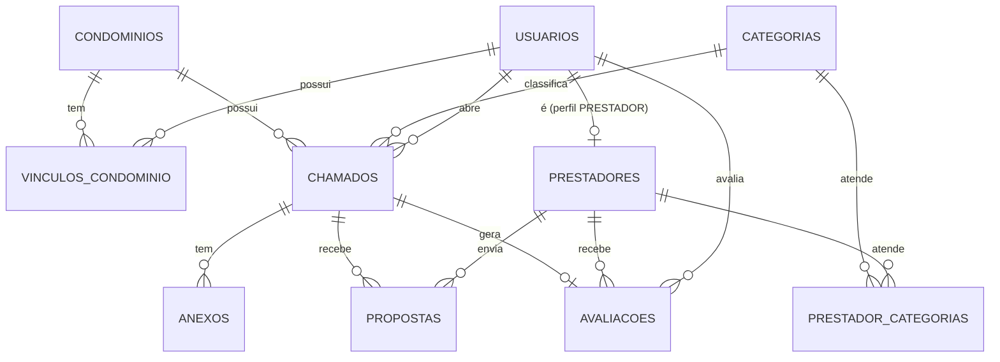

# CLAUDE.md — Backend (API do CondoCheck)

Este repositório é a **API**. O frontend (Next.js) vive em outro repositório (`front`) e consome esta API.
Este arquivo é a fonte de verdade de regras de negócio e decisões técnicas do backend. Se algo aqui mudar, atualize aqui.
Plano de execução em etapas: **[TASKS.md](TASKS.md)** (marque os itens conforme concluir).

## 1. O que é o projeto

**CondoCheck** — plataforma para uma **administradora de condomínios** unir dois modelos: sistema de chamados de manutenção e marketplace de prestadores.
Ciclo: **chamado → propostas → comparação → transferência (admin) → aprovação (síndico) → contato via WhatsApp → conclusão → avaliação**.
Hoje o processo é manual e lento (app "Alvo" + cotação por fora). Origem dos requisitos: entrevista com a PO Yasmin (18/09/2026) e feedback do professor orientador (01/10/2026).

**Vocabulário (feedback de 01/10):** quem atende é **prestador de serviço** (no código, `Prestador`/`PRESTADOR`), nunca "fornecedor" — fornecedor é quem vende produto. A administradora **transfere** a proposta ao síndico (`TRANSFERIDA`), não "indica".

## 2. Stack e decisões

| Camada | Escolha | Observação |
|---|---|---|
| Runtime / framework | Node.js 22 + **Express 5** + TypeScript (ESM, `module: NodeNext` → imports relativos com `.js`) | Sem NestJS, de propósito: curva de aprendizado menor |
| Validação | **Zod** | Um schema por rota (body/query/params) |
| ORM / migrations | **Prisma 6** | Schema em [prisma/schema.prisma](prisma/schema.prisma). Fixar `prisma@6` (a v7 mudou a config de datasource) |
| Banco | PostgreSQL — **Supabase** (prod), Docker (local) | Free: 500 MB, pausa após 7 dias sem uso |
| Autenticação | **Clerk** (`@clerk/express`) — e-mail+senha **e Google** | O front usa telas próprias (não o componente pronto do Clerk). Ver seção 6 e [docs/clerk-setup.md](docs/clerk-setup.md). **Não** usar JWT/bcrypt próprios (cards antigos do Trello estão desatualizados) |
| Upload de arquivos | **Supabase Storage** (bucket privado `anexos`; pastas `chamados/{id}/abertura/`, `formulario/`, `comprovacao/` e `propostas/{propostaId}/`) atrás da interface `Storage` (`src/lib/storage`) | Free: 1 GB. Driver `s3` pronto para migrar a S3/**Cloudflare R2** trocando só variáveis (`STORAGE_DRIVER`). Sem emulador local: dev usa um projeto Supabase de dev. Ver [docs/storage.md](docs/storage.md) |
| Upload no servidor | `multer` (memória) | Máx. 5 MB; tipos aceitos por tipo de anexo (fotos JPG/PNG, comprovação +PDF, formulário PDF/DOCX/XLSX, arquivos da proposta: todos esses). Validar o tipo pelo conteúdo (magic bytes, `file-type`), não só pela extensão |
| WhatsApp | link `https://wa.me/<numero>?text=<msg>` | Sem API oficial, sem custo |
| Mapa | Embed do **OpenStreetMap** no front; coordenadas em `condominios.latitude/longitude` | Sem chave de API e sem custo. Geocodificar o endereço no cadastro do condomínio (ex.: Nominatim, respeitando a política de uso) ou preencher manualmente |
| Deploy da API | **Render** (Web Service Docker, plano free, [render.yaml](render.yaml)) | Railway descartado (sem plano gratuito utilizável). Render free dorme após 15 min sem tráfego (cold start ~1 min). Imagem Docker = portável para Koyeb/Northflank/Cloud Run. Alternativas na seção 12 |
| CI/CD | **GitHub Actions** | Lint + typecheck + testes + build em PR; deploy na `main` via *Deploy Hook* do Render |
| Testes | Vitest + Supertest | Clerk e Prisma mockados nos testes de rota |

## 3. Perfis e permissões

Perfis: `ADMIN` (administradora), `SINDICO`, `FISCAL`, `ZELADOR`, `PRESTADOR`. **Morador não tem acesso.**
Escopo por condomínio: SINDICO/FISCAL/ZELADOR só acessam condomínios vinculados (`vinculos_condominio`). ADMIN acessa todos.

| Ação | ADMIN | SINDICO | FISCAL | ZELADOR | PRESTADOR |
|---|:-:|:-:|:-:|:-:|:-:|
| Gerenciar usuários e condomínios | ✔ | | | | |
| Aprovar/bloquear prestador | ✔ | | | | |
| Abrir chamado | ✔ | ✔ | ✔ | só **limpeza** | |
| Categoria TI (uso interno) | ✔ | | | | |
| Ver chamados | todos | do(s) seu(s) condomínio(s) | do(s) seu(s) | só os que abriu | mural (ver abaixo) |
| Ver/comparar propostas | ✔ | ✔ | | | só as próprias |
| Transferir proposta ao síndico | ✔ | | | | |
| Aprovar ou **reprovar** a proposta transferida | | ✔ | | | |
| Anexar **formulário** para o prestador preencher | ✔ | ✔ | ✔ | | |
| Devolver o formulário preenchido com a proposta | | | | | ✔ |
| Concluir / cancelar chamado | ✔ | ✔ | | | |
| Avaliar prestador | ✔ | ✔ | | | |
| Ver avaliações de prestadores (todos os condomínios) | ✔ | ✔ | | | próprias |
| Enviar/editar/cancelar proposta | | | | | ✔ |
| Enviar **comprovação** do serviço (fotos/PDF, opcional) | | | | | ✔ (só o aprovado) |
| Ver comprovações | ✔ | ✔ | | | as próprias |

- **Mural do prestador:** só chamados `ABERTO`, dentro do prazo, de categorias em que ele é `APROVADO`. Expõe título, categoria, descrição, urgência, fotos, bairro/cidade. **Nunca** endereço completo nem dados de moradores (LGPD).
- Avaliações mostram nota e comentário, **sem** identificar o condomínio avaliador.
- **Mapa / localização:** ADMIN, SINDICO, FISCAL e ZELADOR recebem as coordenadas exatas e o endereço do condomínio. O **prestador só recebe coordenadas arredondadas a 2 casas (~1 km) e sem endereço** enquanto não for o aprovado (`proposta.status = ACEITA`); depois disso, recebe exatas + endereço. O arredondamento é feito **na API**, nunca no front.

## 4. Fluxo do chamado

```
ABERTO ──(admin transfere proposta)──▶ AGUARDANDO_APROVACAO ──(síndico aprova)──▶ EM_EXECUCAO ──▶ CONCLUIDO ──▶ (avaliação)
  ▲                                        │
  └──────────(síndico reprova)─────────────┘
  └────────────── cancelar (admin/síndico, qualquer estado antes de CONCLUIDO) ──▶ CANCELADO
```

- **Prazo de propostas** (`prazoPropostasAte`): NORMAL = criação + 48 h; URGENTE = definido na abertura. Depois do prazo, o servidor recusa novas propostas.
- **Mínimo de 3 propostas:** o sistema *avisa* (campo `alertaPoucasPropostas` na resposta) quando há menos de 3; não bloqueia.
- **Urgente** = imediato: destaque visual e ordenação no topo do mural (não há push, ver seção 9).
- Ao aprovar: a proposta vira `ACEITA`, **todas as demais viram `RECUSADA` de uma vez** (o síndico não reprova uma por uma; a confirmação informa quantas serão recusadas), chamado vai para `EM_EXECUCAO`. `GET /chamados/:id/whatsapp` devolve o link `wa.me` do prestador com mensagem pré-pronta; **quem envia é o condomínio/administradora**, a mensagem não sai do sistema.
- **Reprovar** (síndico, só a proposta `TRANSFERIDA`, motivo opcional em `propostas.motivo_recusa`): a proposta vira `RECUSADA`, o chamado volta para `ABERTO` e a administradora transfere outra. As demais propostas continuam em disputa. Evento `REPROVADA` (marco). Depois do prazo não entram propostas novas, mas a administradora ainda pode transferir uma das existentes.
- Só existe **1 proposta TRANSFERIDA/ACEITA por chamado** (índice único parcial, ver schema).
- **Formulário para o prestador:** quem abre o chamado pode anexar formulários (`anexos.tipo = FORMULARIO`: PDF, DOCX ou XLSX, até 5 MB). Se o chamado tiver formulário, **a proposta só é aceita com pelo menos um arquivo devolvido** (`anexos.tipo = PROPOSTA`, ligado a `proposta_id`; JPG/PNG/PDF/DOCX/XLSX). Ao editar a proposta, os arquivos já enviados contam. O prestador baixa o formulário no mural; ADMIN/SINDICO veem os arquivos devolvidos na comparação.
- Só se avalia chamado `CONCLUIDO`, 1 avaliação por chamado.
- Aprovar prestador exige `emiteNotaFiscal = true`.
- **Comprovação do serviço** (opcional): só o prestador da proposta `ACEITA`, com o chamado em `EM_EXECUCAO` ou `CONCLUIDO`, envia fotos (JPG/PNG) ou PDF (até 5 MB cada). Vira `anexos(tipo = COMPROVACAO)` + evento `COMPROVACAO_ENVIADA`. Não bloqueia a conclusão do chamado.
- **Linha do tempo:** todo service que muda estado, transfere/aprova/reprova proposta ou anexa comprovação grava `chamado_eventos` **na mesma transação**. Marcos (`marco = true`): abertura, 3ª proposta (mínimo atingido), aprovação, reprovação, conclusão, cancelamento.

## 5. Requisitos

### Funcionais

| Cód. | Descrição |
|---|---|
| RF01 | Cadastrar/gerenciar usuários (admin, síndico, fiscal, zelador) |
| RF02 | Abrir chamado: tipo de serviço (título), categoria, local, urgência, descrição |
| RF02a | Foto opcional; front incentiva o envio (foto agiliza a manutenção) |
| RF03 | Comparar propostas lado a lado (valor, prazo de execução, disponibilidade, nota do prestador) |
| RF04 | Admin transfere proposta; síndico aprova (aceite final, **independe do valor**) |
| RF05 | Buscar/filtrar prestadores por categoria |
| RF06 | Avaliar prestador: **nota geral 1–5** + comentário, por quem contratou (síndico ou admin) |
| RF06b | Avaliações visíveis a síndicos e admin, nunca a moradores |
| RF07 | Concluir ou cancelar chamado |
| RF08 | Histórico de chamados com status |
| RF09 | Prestador só entra após **pré-cadastro + aprovação** da admin |
| RF09a | Cadastro de prestador informa se emite nota fiscal (obrigatório); aprovação exige "sim" |
| RF10 | Prestador se cadastra por e-mail + senha ou Google (Clerk), depois informa telefone/WhatsApp, categorias, área de atuação e nota fiscal |
| RF12 | Prestador vê mural filtrado pelas suas categorias |
| RF13 | Proposta: valor, data/hora de disponibilidade, tempo de execução (todos obrigatórios) |
| RF14 | Editar/cancelar proposta antes do aceite |
| RF15 | Prestador acompanha aceite/recusa **no painel** (sem push, ver seção 9) |
| RF16 | Histórico de chamados atendidos pelo prestador |
| RF17 | Link `wa.me` com mensagem pré-pronta ao aprovar (é também o "aviso" ao prestador) |
| RF18 | Média de avaliação por prestador mantida automaticamente |
| RF20 | Controle de acesso por perfil (seção 3) |
| RF21 | Urgente tratado como imediato (destaque + prioridade) |
| RF22 | Prazo de propostas: normal até 48 h; urgente imediato |
| RF23 | Aviso quando houver menos de 3 propostas |
| RF24 | Categoria TI disponível, marcada "uso interno" (só ADMIN) |
| RF25 | **Mapa do local** no chamado (OpenStreetMap, sem chave de API); prestador vê só a região aproximada até ser aprovado |
| RF26 | **Comprovação do serviço**: quem atendeu pode enviar fotos/PDF (opcional) |
| RF27 | **Histórico** (linha do tempo) do chamado, com marcos em destaque |
| RF28 | **Formulário** anexado na abertura (PDF/DOCX/XLSX); prestador devolve preenchido junto da proposta (obrigatório quando houver formulário) |
| RF29 | Síndico **reprova** a proposta transferida (motivo opcional); chamado volta para a administradora |

Substituições em relação ao rascunho anterior: RF11 (login por celular+senha) virou e-mail+senha **ou Google** no Clerk; RF19 (notificar prestadores) virou o link do WhatsApp (RF17); RF06a (3 critérios) virou nota geral única.

### Não funcionais

| Cód. | Descrição |
|---|---|
| RNF01/11 | Responsivo; mesmo layout para todos os perfis (muda só permissão) — responsabilidade do front |
| RNF02 | Endpoints principais respondem em < 2 s |
| RNF03 | Senhas e sessões **delegadas ao Clerk** (a API nunca vê senha) |
| RNF04 | HTTPS em todo tráfego (Render e Vercel já fornecem) |
| RNF05 | Upload: até 5 MB por arquivo; tipos por uso (fotos JPG/PNG; comprovação +PDF; formulário PDF/DOCX/XLSX) |
| RNF06 | Compatível com Chrome, Firefox, Edge e Safari |
| RNF07 | Suportar 50+ usuários simultâneos |
| RNF08 | Código versionado em Git |
| RNF10 | **LGPD**: dados isolados por `condominio_id`; toda query filtra pelo escopo do usuário |

## 6. Autenticação e usuários (Clerk)

- Clerk **free**: senha, e-mail e login social (Google) ok; **login por SMS/celular é pago** e roles customizadas não existem no plano free. Por isso: login = e-mail + senha **ou Google**, e **o perfil vive na tabela `usuarios`** (fonte de verdade), não em claims do Clerk.
- **Login por celular (avaliado em set/2026):** o SMS do Clerk exige o plano Pro (US$ 25/mês) mais tarifa por mensagem ("taxa de mercado" fora de EUA/Canadá); por padrão só EUA e Canadá estão habilitados na lista de países, e o Brasil não aparece listado nas páginas consultadas. Custo recorrente incompatível com o escopo; o celular fica só como dado de contato. Alternativa gratuita para "entrar sem senha": **código de 6 dígitos por e-mail** (disponível no plano Hobby; método `signIn.emailCode`). Ainda **não** implementado; requer testar no dashboard se convive com a senha ativa. Login por WhatsApp exigiria a API oficial (custo e aprovação) — descartado.
- A tela de login/cadastro é **própria** (feita no front com a API de fluxos customizados do Clerk). Para a API isso é transparente: só valida o token da sessão.
- **Vínculo por e-mail:** quem entra com Google usa o e-mail verificado pelo Google; o casamento com o pré-cadastro (síndico/fiscal/zelador) é por esse e-mail, então só confie em e-mail **verificado** (`email_verified`/endereço verificado no Clerk).
- O front envia `Authorization: Bearer <token da sessão Clerk>`. A API valida com `clerkMiddleware()` e, em seguida, um middleware `carregarUsuario` busca `usuarios` por `clerk_user_id` e injeta `req.usuario` (perfil + condomínios).
- Usuários internos (síndico, fiscal, zelador, admin) são **pré-cadastrados pela admin** (`usuarios` com `clerk_user_id = null`) e convidados por e-mail. No 1º login, o `carregarUsuario` casa pelo e-mail verificado e grava o `clerk_user_id`.
- **Prestador** se cadastra sozinho: usuário Clerk sem linha em `usuarios` só pode chamar `POST /prestadores/cadastro`, que cria `usuarios(PRESTADOR)` + `prestadores(PENDENTE)`. Sem aprovação da admin ele não vê o mural.
- **Primeiro ADMIN:** `npm run seed` cria a linha a partir de `SEED_ADMIN_EMAIL` e as categorias iniciais.
- Autorização: middleware `exigirPerfil(...)` por rota + **filtro de condomínio nos services** (nunca só no controller).

## 7. Modelo de dados

Schema completo em [prisma/schema.prisma](prisma/schema.prisma). Diagrama, dicionário de dados e regras: **[docs/modelagem-banco.md](docs/modelagem-banco.md)** (imagem: [docs/modelagem-banco.png](docs/modelagem-banco.png)).



Pontos de atenção:
- `mediaAvaliacao`/`totalAvaliacoes` em `prestadores` são desnormalizados: atualizar **na mesma transação** que grava a avaliação.
- Constraints em SQL (CHECK de nota 1–5, valor > 0, tamanho ≤ 5 MB, índice único parcial de proposta selecionada) ficam no topo do schema; incluí-las na primeira migration (`prisma migrate dev --create-only`, editar o SQL, depois aplicar).
- Anexos: guardar só `storagePath`; a API gera **URL assinada** (curta duração) ao devolver o chamado.
- IDs são UUID; `chamados.numero` é o protocolo legível.

## 8. API (rascunho)

Prefixo `/api`. Toda rota exige sessão Clerk, exceto `GET /api/health` (consulta o banco; usado pelo health check do Render e pelo ping que mantém Render/Supabase acordados).
Respostas seguem os tipos de `front/types/index.ts` (serializer por módulo: `Decimal` → `number`, datas ISO).

| Método e rota | Perfis | Descrição |
|---|---|---|
| `GET /me` | todos | Usuário atual, perfil, condomínios |
| `POST /prestadores/cadastro` | Clerk sem vínculo | Auto-cadastro do prestador |
| `GET/POST/PATCH /usuarios` | ADMIN | CRUD e vínculos com condomínios |
| `GET/POST/PATCH /condominios` | ADMIN | CRUD |
| `GET /categorias` | todos | Lista (TI só para ADMIN) |
| `GET /prestadores`, `GET /prestadores/:id` | ADMIN, SINDICO | Busca por categoria/status; detalhe com avaliações |
| `PATCH /prestadores/:id/aprovar` · `/bloquear` | ADMIN | Exige nota fiscal para aprovar |
| `PATCH /prestadores/me` | PRESTADOR | Editar o próprio cadastro |
| `POST /chamados` · `GET /chamados` · `GET /chamados/:id` | conforme seção 3 | Abrir, listar (com escopo), detalhar. **A listagem é paginada** (`?page=1&pageSize=5&busca=&categoriaId=&situacao=`) e devolve `{ itens, total }`; cada item traz `totalPropostas`, **`menorValor`** (menor proposta ainda em disputa) e **`valorContratado`** (proposta `ACEITA`), usados no card da lista |
| `POST /chamados/:id/anexos` | quem abriu | Upload de foto da abertura: JPG/PNG ≤ 5 MB |
| `POST /chamados/:id/formularios` | quem abriu (enquanto `ABERTO` e sem propostas) | Formulário para o prestador: PDF/DOCX/XLSX ≤ 5 MB, 1 por requisição |
| `POST /chamados/:id/comprovacoes` | PRESTADOR aprovado | Upload de comprovação: JPG/PNG/PDF ≤ 5 MB, 1 arquivo por requisição |
| `PATCH /chamados/:id/cancelar` · `/concluir` | ADMIN, SINDICO | |
| `GET /chamados/:id/propostas` | ADMIN, SINDICO | Comparação (cartão por prestador). Cada proposta traz o prestador com `mediaAvaliacao`, `totalAvaliacoes` e **`totalServicos`** (chamados concluídos em que ele foi o `ACEITA`) |
| `GET /prestadores/:id/historico` | ADMIN, SINDICO | Painel da tela de avaliação: `{ media, totalServicos, porCategoria[], prazoCumprido: { cumpridos, total }, ultimoServicoEm }`. **Prazo cumprido** = concluídos com `concluido_em <= disponivel_em + tempo_execucao_horas` da proposta aceita; nada novo no banco, é derivado |
| `GET /chamados/:id` | conforme seção 3 | Inclui `formularios` (URL assinada, visíveis também ao prestador no mural), `localizacao` (`{ precisao: EXATA\|APROXIMADA, latitude, longitude, endereco? }` já filtrada pelo perfil), `comprovacoes` (URL assinada) e `eventos` (linha do tempo) |
| `POST /chamados/:id/transferir` | ADMIN | `{ propostaId }` → AGUARDANDO_APROVACAO |
| `POST /chamados/:id/aprovar` | SINDICO | `{ propostaId }` → EM_EXECUCAO; demais propostas `RECUSADA` |
| `POST /chamados/:id/reprovar` | SINDICO | `{ propostaId, motivo? }` → proposta `RECUSADA`, chamado volta para ABERTO |
| `GET /chamados/:id/whatsapp` | ADMIN, SINDICO | Link `wa.me` pré-preenchido |
| `GET /mural` | PRESTADOR | Chamados abertos das suas categorias |
| `POST /chamados/:id/propostas` | PRESTADOR | Enviar ou editar (upsert: 1 por prestador/chamado). `multipart/form-data` com os campos + `arquivos` (obrigatório se o chamado tiver formulário e a proposta ainda não tiver arquivo) |
| `PATCH /propostas/:id/cancelar` | PRESTADOR | Cancelar antes do aceite |
| `GET /propostas/minhas` | PRESTADOR | Histórico |
| `POST /chamados/:id/avaliacao` | ADMIN, SINDICO | `{ nota, comentario? }` |

Erros: JSON `{ erro: { codigo, mensagem } }` com status HTTP correto (400 validação, 401, 403 perfil/escopo, 404, 409 regra de negócio).

## 9. Fora de escopo (v1)

- Notificações push/e-mail/SMS: o único "aviso" ao prestador é o link do WhatsApp aberto pelo condomínio; o resto é consulta no painel.
- Login por celular (SMS pago no Clerk).
- Acesso de moradores.
- API oficial do WhatsApp Business.

## 10. Estrutura e convenções

```
src/
  app.ts / server.ts       # criarApp() (testável com supertest) / listen + desligamento gracioso
  config/env.ts            # valida variáveis com Zod; o resto do código importa `env`, nunca process.env
  middlewares/             # erro (AppError), auth (clerk + carregarUsuario), exigirPerfil, upload
  lib/                     # prisma.ts, logger.ts, storage/ (supabase | s3), whatsapp.ts
  modules/health/          # GET /api/health
  modules/<dominio>/       # chamados, propostas, prestadores, avaliacoes, usuarios, condominios, categorias
    <dominio>.routes.ts    # rotas + validação Zod
    <dominio>.controller.ts# HTTP apenas
    <dominio>.service.ts   # regra de negócio + escopo (condominio_id)
    <dominio>.schemas.ts
prisma/ (schema.prisma, migrations/, seed.ts)
```

- Fluxo: `routes → controller → service → prisma`. Regra de negócio e filtro de escopo **só no service**.
- Domínio em português (`Chamado`, `Proposta`), infraestrutura em inglês (`middleware`, `env`). Tabelas em snake_case via `@@map`.
- Transições de status centralizadas em uma função (máquina de estados) — não altere `status` direto pelo Prisma fora dela.
- TypeScript `strict`; ESLint + Prettier; commits em Conventional Commits.

## 11. Ambiente local

```bash
cp .env.example .env            # Clerk/Supabase podem ficar vazios no começo
npm install                     # também no host: editor, lint e prisma CLI
docker compose up -d            # Postgres (localhost:5432) + API com hot reload (localhost:3333)
npx prisma migrate dev          # aplica migrations (do host, via localhost:5432)
npm run seed                    # categorias + 1º ADMIN (SEED_ADMIN_EMAIL)
curl localhost:3333/api/health
```

- Alternativa sem a API em contêiner: `docker compose up -d db` e `npm run dev` no host.
- Mudou `package.json`? `docker compose up -d --build api` (o `node_modules` do contêiner é separado do host).
- Logs: `docker compose logs -f api`. Banco: `npm run db:studio`. `docker compose down -v` apaga o banco local.
- Verificações (as mesmas do CI): `npm run lint && npm run typecheck && npm test && npm run build`.
- Anexos não rodam local: preencha `SUPABASE_URL`/`SUPABASE_SERVICE_ROLE_KEY` de um projeto Supabase de dev (bucket privado `anexos`). Sem isso a API sobe, só o upload falha.
- Clerk: [docs/clerk-setup.md](docs/clerk-setup.md). Sem as chaves, a API sobe (só `/api/health` funciona até a Etapa 1).

## 12. Deploy e CI/CD

Passo a passo completo: **[docs/deploy.md](docs/deploy.md)**.

- **Banco:** projeto Supabase (região EUA-Leste, junto do Render). A API usa `DATABASE_URL` (Transaction pooler, 6543, `?pgbouncer=true&connection_limit=1`); migrations usam `DIRECT_URL` (**Session pooler**, 5432 — a conexão direta é só IPv6 e o GitHub Actions não tem IPv6). Free pausa após 7 dias sem uso.
- **API:** Render, runtime Docker (último estágio do [Dockerfile](Dockerfile)), definido no [render.yaml](render.yaml), `autoDeploy: false`.
- **GitHub Actions** ([.github/workflows](.github/workflows))
  - PR e `main`: `npm ci` → lint → typecheck → test → build → `docker build`.
  - Push na `main`: `prisma migrate deploy` → `curl` no Deploy Hook do Render (a API nova nunca sobe antes da migration).
  - Secrets: `DIRECT_URL`, `RENDER_DEPLOY_HOOK_URL`. Variable opcional `API_HEALTH_URL` liga o ping a cada 10 min (07h–21h) em `manter-acordado.yml`.

### Onde hospedar a API (pesquisa em set/2026)

| Opção | Gratuito? | Prós | Contras |
|---|---|---|---|
| **Render** (escolhida) | Sim, sem cartão | Node/Express "de verdade", deploy por hook, simples | Dorme após 15 min; ~1 min de cold start; 512 MB RAM |
| **Vercel** (Express como Function) | Sim (Hobby) | Mesmo painel do front; deploy trivial | Serverless: limite curto de execução (10 s no Hobby), sem WebSocket/jobs, Hobby é **uso não comercial**; corpo de requisição limitado (~4,5 MB, confirmar na doc) conflita com upload de 5 MB pela API — exigiria upload **direto** front → Supabase Storage com URL assinada |
| **Northflank** | Sim, mas pede cartão para verificação | Serviço que não dorme | Cartão; interface mais técnica |
| **Koyeb** | Sim, pede cartão | 1 serviço gratuito, escala a zero | Cartão; só 1 serviço |
| **Google Cloud Run** | Cota gratuita generosa | Escala a zero, bom cold start | Exige conta de faturamento (cartão) e Docker |
| Railway | Não (US$1/mês de crédito; trial de US$5/30 dias) | — | Descartado |
| Fly.io | Não para contas novas | — | Descartado |

Recomendação: **Render** agora (zero custo, zero cartão). Se o cold start atrapalhar a apresentação, dá para manter a API "acordada" com um *ping* agendado (ex.: GitHub Actions `schedule` chamando `/health` a cada 10 min) ou migrar para Northflank/Koyeb. A migração é barata: a API é um Express comum, só muda o destino do deploy.

## 13. Premissas a confirmar com a PO

1. Prazo padrão de propostas para chamado **urgente** (sugestão: 2 h) — a entrevista só diz "imediato".
2. Quem avalia: assumido síndico **ou** admin em nome do condomínio ("contratante").
3. Síndico pode aprovar direto de `ABERTO`, sem transferência prévia da admin? (hoje: não.)
4. Exibir o nome do condomínio nas avaliações vistas por outros síndicos? (hoje: não, por LGPD.)
