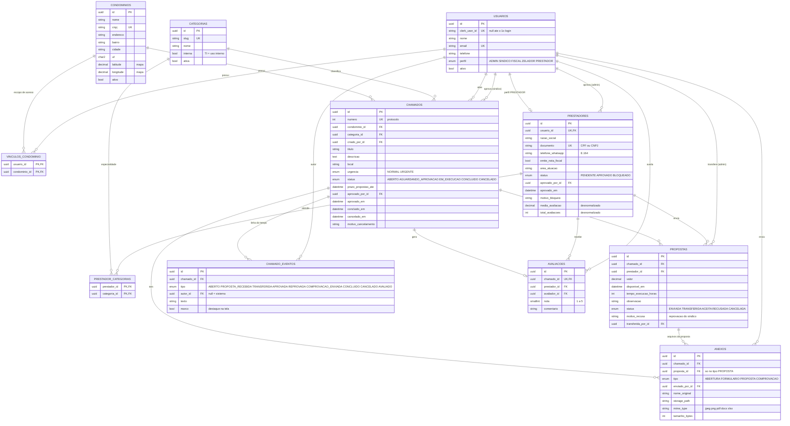

# Modelagem do banco de dados

PostgreSQL (Supabase em produção, Docker em desenvolvimento). Fonte de verdade: [../prisma/schema.prisma](../prisma/schema.prisma).
Imagem do diagrama: [modelagem-banco.png](modelagem-banco.png) (gerada do bloco Mermaid abaixo, arquivo [modelagem-banco.mmd](modelagem-banco.mmd)).

## 1. Diagrama entidade-relacionamento

Todas as tabelas têm também `created_at` e `updated_at` (omitidos acima por clareza; `anexos`, `avaliacoes` e `chamado_eventos` só têm `created_at`).

## 2. Dicionário de entidades

| Tabela | Papel | Observações |
|---|---|---|
| `condominios` | Cada contrato/condomínio atendido pela administradora | É o **tenant** para a LGPD. `latitude`/`longitude` alimentam o mapa (nulas = sem mapa) |
| `usuarios` | Toda pessoa que entra no sistema, com um único `perfil` | `clerk_user_id` liga ao Clerk; fica `null` para quem foi pré-cadastrado e ainda não logou |
| `vinculos_condominio` | N:N usuário ↔ condomínio | SINDICO/FISCAL/ZELADOR só enxergam condomínios vinculados; ADMIN não precisa de vínculo |
| `categorias` | Elétrica, hidráulica, limpeza, infraestrutura, TI | `interna = true` para TI (só ADMIN abre). Tabela e não enum, para a administradora criar novas |
| `prestadores` | Dados do prestador (1:1 com `usuarios` de perfil PRESTADOR) | Nasce `PENDENTE`; só `APROVADO` vê o mural |
| `prestador_categorias` | Especialidades do prestador (N:N) | Define o que ele vê no mural |
| `chamados` | Demanda de manutenção | Fluxo em `status`; `prazo_propostas_ate` limita novas propostas |
| `anexos` | Arquivos do chamado: `ABERTURA` (fotos de quem abriu), `FORMULARIO` (formulário para o prestador preencher), `PROPOSTA` (arquivo devolvido pelo prestador com a proposta, ligado a `proposta_id`) e `COMPROVACAO` (fotos/PDF de quem atendeu, opcional) | Só o caminho no bucket privado; a API gera URL assinada. Tipo de arquivo aceito depende do `tipo` |
| `chamado_eventos` | Linha do tempo do chamado (aberto, propostas, transferência, aprovação, comprovação, conclusão, avaliação) | Gravada na mesma transação da mudança de estado. `marco = true` ganha destaque na tela |
| `propostas` | Orçamento de um prestador para um chamado | 1 por prestador/chamado (editar em vez de reenviar) |
| `avaliacoes` | Nota geral 1–5 após a conclusão | 1 por chamado; atualiza a média do prestador |

## 3. Enums

| Enum | Valores |
|---|---|
| `Perfil` | `ADMIN`, `SINDICO`, `FISCAL`, `ZELADOR`, `PRESTADOR` |
| `StatusPrestador` | `PENDENTE`, `APROVADO`, `BLOQUEADO` |
| `Urgencia` | `NORMAL` (propostas por até 48 h), `URGENTE` (imediato) |
| `StatusChamado` | `ABERTO` → `AGUARDANDO_APROVACAO` → `EM_EXECUCAO` → `CONCLUIDO`; `CANCELADO` a partir de qualquer estado anterior a `CONCLUIDO` |
| `TipoAnexo` | `ABERTURA`, `FORMULARIO`, `PROPOSTA`, `COMPROVACAO` |
| `TipoEvento` | `ABERTO`, `PROPOSTA_RECEBIDA`, `TRANSFERIDA`, `APROVADA`, `REPROVADA`, `COMPROVACAO_ENVIADA`, `CONCLUIDO`, `CANCELADO`, `AVALIADO` |
| `StatusProposta` | `ENVIADA`, `TRANSFERIDA` (admin transferiu ao síndico), `ACEITA` (síndico aprovou), `RECUSADA` (reprovada pelo síndico ou recusada ao aprovar outra), `CANCELADA` (pelo prestador) |

## 4. Restrições e índices

**Únicos:** `usuarios.email`, `usuarios.clerk_user_id`, `prestadores.documento`, `prestadores.usuario_id`, `condominios.cnpj`, `categorias.slug`, `chamados.numero`, `avaliacoes.chamado_id`, `propostas(chamado_id, prestador_id)`.

**Índices de consulta:** `chamados(condominio_id, status)` (lista por escopo), `chamados(categoria_id, status)` (mural), `chamados(status, urgencia, prazo_propostas_ate)` (ordenar urgentes), `propostas(prestador_id)`, `avaliacoes(prestador_id)`, `prestadores(status)`, `anexos(chamado_id, tipo)`, `anexos(proposta_id)`, `chamado_eventos(chamado_id, created_at)`.

**Constraints em SQL** (o Prisma não expressa; entram na 1ª migration, ver topo do schema):

| Regra | SQL |
|---|---|
| Nota entre 1 e 5 | `CHECK (nota BETWEEN 1 AND 5)` em `avaliacoes` |
| Valor positivo | `CHECK (valor > 0)` em `propostas` |
| Arquivo até 5 MB | `CHECK (tamanho_bytes <= 5242880)` em `anexos` |
| Tipo de arquivo por tipo de anexo | `anexos_mime_por_tipo_chk`: ABERTURA = JPG/PNG; COMPROVACAO = JPG/PNG/PDF; FORMULARIO = PDF/DOCX/XLSX; PROPOSTA = JPG/PNG/PDF/DOCX/XLSX |
| Arquivo de proposta sempre ligado a uma proposta | `anexos_proposta_chk`: `(tipo = 'PROPOSTA') = (proposta_id IS NOT NULL)` |
| Só 1 proposta selecionada por chamado | índice único parcial em `propostas(chamado_id) WHERE status IN ('TRANSFERIDA','ACEITA')` |

## 5. Regras de negócio que dependem do banco

| Regra | Onde é garantida |
|---|---|
| Um condomínio não vê dados de outro (LGPD) | Todo `SELECT` de chamados/propostas filtra por `condominio_id` dos `vinculos_condominio` do usuário (service layer) |
| Prestador só entra após aprovação | `prestadores.status`; mural exige `APROVADO` |
| Aprovar prestador exige nota fiscal | Service: `emite_nota_fiscal = true` |
| Zelador só abre chamado de limpeza | Service: `categorias.slug = 'limpeza'` |
| Categoria TI só para ADMIN | Service: `categorias.interna = true` |
| Mínimo de 3 propostas é **aviso**, não bloqueio | Calculado na resposta da API (`count(propostas)`) |
| Só avalia chamado `CONCLUIDO`; 1 avaliação por chamado | Service + `UNIQUE(avaliacoes.chamado_id)` |
| Média do prestador sempre consistente | `media_avaliacao`/`total_avaliacoes` atualizados na **mesma transação** da avaliação |
| Depois do prazo não entram propostas | Service compara `now()` com `prazo_propostas_ate` |
| **Prestador só vê o local exato depois de aprovado** | A API devolve `localizacao` com coordenadas **arredondadas a 2 casas (~1 km)** e sem endereço enquanto a proposta não é `ACEITA`; após aprovação, coordenadas exatas e endereço |
| Só o prestador da proposta `ACEITA` envia comprovação, com o chamado `EM_EXECUCAO` ou `CONCLUIDO` | Service; grava `anexos(tipo = COMPROVACAO)` + evento `COMPROVACAO_ENVIADA` |
| Chamado com formulário exige o formulário devolvido na proposta | Service: se existe `anexos(tipo = FORMULARIO)` no chamado, a proposta precisa de ≥ 1 `anexos(tipo = PROPOSTA)` |
| Síndico reprova só a proposta transferida | Service: proposta `TRANSFERIDA` → `RECUSADA` (+ `motivo_recusa`), chamado `AGUARDANDO_APROVACAO` → `ABERTO`, evento `REPROVADA` |
| Comprovação é opcional e visível só para ADMIN, SINDICO do condomínio e o próprio prestador | Service (escopo por `condominio_id` / `prestador_id`) |
| Linha do tempo sempre coerente com o estado | Todo service que muda `status`, transfere/aprova proposta ou anexa comprovação insere `chamado_eventos` na mesma transação |

## 6. O que mudou em relação ao modelo do rascunho

| Antes | Agora | Motivo |
|---|---|---|
| `usuarios_admin` (só admin) | `usuarios` com `perfil` | Entrevista: admin, síndico, fiscal, zelador e prestador |
| — | `condominios` + `vinculos_condominio` | LGPD: isolar dados por condomínio (`condominio_id`) |
| `prestadores` com telefone e senha | `prestadores` ligado a `usuarios`; login no Clerk | Autenticação delegada (e-mail/senha e Google) |
| `especialidades` | `categorias` (+ `interna`) e `prestador_categorias` | TI como uso interno; prestador com várias especialidades |
| — | `emite_nota_fiscal`, `status`, aprovação | Pré-cadastro e aprovação obrigatórios |
| `chamados.status` genérico | Fluxo com `AGUARDANDO_APROVACAO` + `aprovado_por_id` | Admin transfere, síndico aprova |
| Sem prazo | `prazo_propostas_ate`, urgência `NORMAL/URGENTE` | 48 h vs. imediato |
| Sem fotos | `anexos` (`tipo` ABERTURA/FORMULARIO/PROPOSTA/COMPROVACAO) | Foto opcional na abertura; formulário para o prestador; comprovação do serviço por quem atendeu |
| `fornecedores`, perfil `FORNECEDOR` | `prestadores`, perfil `PRESTADOR` | Feedback do professor (01/10): "fornecedor" é quem vende produto |
| Proposta `INDICADA` | `TRANSFERIDA` + reprovação pelo síndico (`motivo_recusa`, evento `REPROVADA`) | Feedback do professor (01/10) |
| — | `condominios.latitude/longitude` | Mapa do local |
| — | `chamado_eventos` | Linha do tempo do chamado |
| `propostas.tempo_previsto` texto | `tempo_execucao_horas` inteiro + `disponivel_em` datetime | Comparação e ordenação; disponibilidade obrigatória |
| `avaliacoes` com nota e comentário | Idem, com `avaliador_id` e nota geral única | Decisão: nota geral definida pelo contratante |
