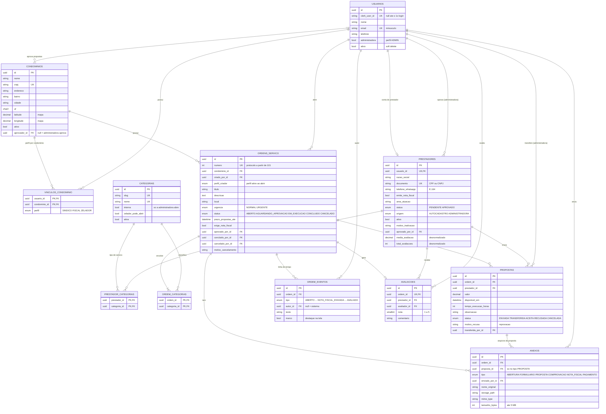

# Modelagem do banco de dados

PostgreSQL (Supabase em produção, Docker em desenvolvimento). Fonte de verdade: [../prisma/schema.prisma](../prisma/schema.prisma).
Imagem do diagrama: [modelagem-banco.png](modelagem-banco.png), gerada do bloco abaixo ([modelagem-banco.mmd](modelagem-banco.mmd)) com
`npx -p @mermaid-js/mermaid-cli mmdc -i docs/modelagem-banco.mmd -o docs/modelagem-banco.png -s 2 -b white`.

Versão de 06/11/2026: aplica a reunião com o professor de 04/10/2026 (ordem de serviço, perfil por condomínio,
aprovador por condomínio, vários tipos de serviço por ordem, nota fiscal e comprovante de pagamento).

## 1. Diagrama entidade-relacionamento

Todas as tabelas têm `created_at`; as editáveis também `updated_at` (omitidos acima por clareza).

## 2. Dicionário de entidades

| Tabela | Papel | Observações |
|---|---|---|
| `condominios` | Cada condomínio atendido pela administradora | É o **tenant** da LGPD. `aprovador_id` = pessoa que aprova/reprova as propostas (null = a própria administradora). `latitude`/`longitude` alimentam o mapa |
| `usuarios` | Toda conta: pessoas (administradora, síndico, fiscal, zelador) e prestadores | `administradora = true` → perfil ADMIN. `clerk_user_id` fica `null` até o 1º login (vínculo pelo e-mail verificado). `ativo = false` = desativado (soft delete) |
| `vinculos_condominio` | Pessoa ↔ condomínio **com o perfil** dela ali | Um perfil por condomínio (PK composta). A mesma pessoa pode ser fiscal num e síndica noutro. Define o escopo LGPD |
| `categorias` | Tipos de serviço (Elétrica, Piscina…) cadastrados pela administradora | `interna` (só a administradora abre; fora do autocadastro), `zelador_pode_abrir`, `ativa` (inativa some das escolhas, continua nas ordens antigas) |
| `prestadores` | Cadastro do prestador (1:1 com `usuarios`) | `status` PENDENTE/APROVADO; `ativo` + `motivo_inativacao` para desativar/reativar; `origem` AUTOCADASTRO (entra PENDENTE) ou ADMINISTRADORA (entra APROVADO). E-mail e nome do contato ficam em `usuarios` |
| `prestador_categorias` | N:N prestador ↔ tipo de serviço | Define o mural |
| `ordens_servico` | A ordem de serviço | `numero` é o protocolo legível (começa em 101). `perfil_criador` guarda o perfil ativo de quem abriu. `exige_nota_fiscal` trava a conclusão até a NF chegar |
| `ordem_categorias` | N:N ordem ↔ tipo de serviço | Uma ordem pode envolver vários tipos; o mural mostra a quem atende **qualquer** um deles |
| `anexos` | Arquivos da ordem | `tipo`: ABERTURA, FORMULARIO, PROPOSTA (com `proposta_id`), COMPROVACAO, NOTA_FISCAL, PAGAMENTO. Só o caminho no bucket privado; a API gera URL assinada |
| `ordem_eventos` | Linha do tempo | Gravada na mesma transação de cada mudança; `marco` destaca abertura, 3ª proposta, aprovação, reprovação, conclusão e cancelamento |
| `propostas` | Proposta de um prestador para uma ordem | 1 por prestador/ordem (editar = upsert). `motivo_recusa` quando o aprovador reprova |
| `avaliacoes` | Nota geral 1–5 + comentário | 1 por ordem concluída; atualiza `media_avaliacao`/`total_avaliacoes` do prestador na mesma transação |

## 3. Enums

| Enum | Valores |
|---|---|
| `Perfil` | ADMIN, SINDICO, FISCAL, ZELADOR, PRESTADOR (perfil ativo; usado em `perfil_criador`) |
| `PerfilCondominio` | SINDICO, FISCAL, ZELADOR |
| `StatusPrestador` | PENDENTE, APROVADO (desativar é `ativo = false`) |
| `OrigemPrestador` | AUTOCADASTRO, ADMINISTRADORA |
| `StatusOrdem` | ABERTO, AGUARDANDO_APROVACAO, EM_EXECUCAO, CONCLUIDO, CANCELADO |
| `StatusProposta` | ENVIADA, TRANSFERIDA, ACEITA, RECUSADA, CANCELADA |
| `TipoAnexo` | ABERTURA, FORMULARIO, PROPOSTA, COMPROVACAO, NOTA_FISCAL, PAGAMENTO |
| `TipoEvento` | ABERTO, PROPOSTA_RECEBIDA, TRANSFERIDA, APROVADA, REPROVADA, COMPROVACAO_ENVIADA, NOTA_FISCAL_ENVIADA, CONCLUIDO, CANCELADO, AVALIADO |

## 4. Chaves, índices e constraints

**Únicos:** `usuarios.email`, `usuarios.clerk_user_id`, `condominios.cnpj`, `categorias.slug`, `categorias.nome`, `prestadores.usuario_id`, `prestadores.documento`, `ordens_servico.numero`, `propostas(ordem_id, prestador_id)`, `avaliacoes.ordem_id`.

**Índices de consulta:** `ordens_servico(condominio_id, status)` (lista por escopo), `ordens_servico(criado_por_id)` (zelador vê as que abriu), `ordens_servico(status, urgencia, prazo_propostas_ate)` (mural e urgentes no topo), `ordem_categorias(categoria_id)` (mural), `prestador_categorias(categoria_id)`, `prestadores(status, ativo)`, `propostas(prestador_id, status)`, `anexos(ordem_id, tipo)`, `anexos(proposta_id)`, `ordem_eventos(ordem_id, created_at)`, `vinculos_condominio(condominio_id)`.

**Constraints em SQL** (o Prisma não expressa; estão no fim da migration inicial):

| Regra | SQL |
|---|---|
| Nota entre 1 e 5 | `avaliacoes_nota_chk` |
| Valor e tempo de execução positivos | `propostas_valor_chk`, `propostas_tempo_execucao_chk` |
| Arquivo até 5 MB | `anexos_tamanho_chk` |
| Tipo de arquivo por tipo de anexo | `anexos_mime_por_tipo_chk`: ABERTURA = JPG/PNG; FORMULARIO = PDF/DOCX/XLSX; PROPOSTA = JPG/PNG/PDF/DOCX/XLSX; COMPROVACAO, NOTA_FISCAL e PAGAMENTO = JPG/PNG/PDF |
| Arquivo de proposta sempre ligado a uma proposta | `anexos_proposta_chk` |
| CPF/CNPJ só com dígitos | `prestadores_documento_chk` (11 ou 14 dígitos) |
| E-mail em minúsculas | `usuarios_email_minusculo_chk` (o vínculo do 1º login compara e-mails) |
| Só 1 proposta selecionada por ordem | índice único parcial `propostas_uma_selecionada_idx` em `propostas(ordem_id) WHERE status IN ('TRANSFERIDA','ACEITA')` |
| Protocolo começa em #101 | `ALTER SEQUENCE ordens_servico_numero_seq RESTART WITH 101` |

## 5. Regras de negócio que dependem do banco (garantidas no service)

| Regra | Onde |
|---|---|
| Um condomínio não vê dados de outro (LGPD) | Toda consulta de ordens/propostas filtra pelos condomínios do perfil ativo (`vinculos_condominio`); ZELADOR só as que abriu (`criado_por_id`); ADMIN vê todas |
| Perfil ativo | Cabeçalho `X-Perfil`; a API confere que a pessoa tem esse perfil (vínculo, `administradora` ou `prestadores`) |
| Quem aprova | `condominios.aprovador_id` (pessoa ativa e vinculada ao condomínio) ou, se null, qualquer pessoa da administradora — que então aprova direto de ABERTO |
| Não desativar/desvincular quem é aprovador | 409 `PESSOA_E_APROVADORA` |
| Prestador só vê o mural se APROVADO e ativo | `prestadores.status`, `prestadores.ativo` |
| Aprovar prestador exige nota fiscal | Service (`emite_nota_fiscal = true` no momento da aprovação; não é CHECK porque ele pode deixar de emitir depois e ser desativado) |
| Zelador só abre tipos liberados; tipos internos só a administradora | `categorias.zelador_pode_abrir`, `categorias.interna` |
| Mínimo de 3 propostas é aviso | Calculado na resposta |
| Depois do prazo não entram propostas | `now()` × `prazo_propostas_ate` |
| Ordem com formulário exige o arquivo devolvido na proposta | ≥ 1 `anexos(tipo = PROPOSTA)` da proposta; senão 409 `FORMULARIO_OBRIGATORIO` |
| Conclusão exige comprovante de pagamento e, se `exige_nota_fiscal`, a NF | 409 `NOTA_FISCAL_PENDENTE` |
| Prestador só vê o local exato depois de aprovado | Localização arredondada a 2 casas, sem endereço, até a proposta ser ACEITA |
| Média do prestador consistente | Atualizada na mesma transação da avaliação |
| Linha do tempo coerente | Evento gravado na mesma transação de cada mudança |

## 6. O que mudou em relação à modelagem anterior (02/10/2026)

| Antes | Agora | Motivo |
|---|---|---|
| `chamados`, `chamado_eventos`, `StatusChamado` | `ordens_servico`, `ordem_eventos`, `StatusOrdem` | Reunião de 04/10: "ordem de serviço" |
| `usuarios.perfil` (um perfil por pessoa) | `usuarios.administradora` + `vinculos_condominio.perfil` | Mesma pessoa com perfis diferentes em condomínios diferentes |
| Síndico aprova | `condominios.aprovador_id` (null = administradora) | Cada condomínio define quem aprova |
| `chamados.categoria_id` | `ordem_categorias` (N:N) | Uma ordem pode envolver vários tipos de serviço |
| `categorias` com `interna`/`ativa` | + `zelador_pode_abrir`, `nome` único | Tipos de serviço cadastrados pela administradora |
| `StatusPrestador.BLOQUEADO`, `motivo_bloqueio` | `ativo` + `motivo_inativacao`; `origem` | Desativar/reativar sem apagar; cadastro pela administradora |
| — | `ordens_servico.exige_nota_fiscal`, anexos `NOTA_FISCAL` e `PAGAMENTO`, evento `NOTA_FISCAL_ENVIADA` | Nota fiscal e comprovante de pagamento |
| — | `perfil_criador`, `concluido_por_id`, `cancelado_por_id`, `propostas.transferida_em` | Linha do tempo e "aberta por" com o perfil |
